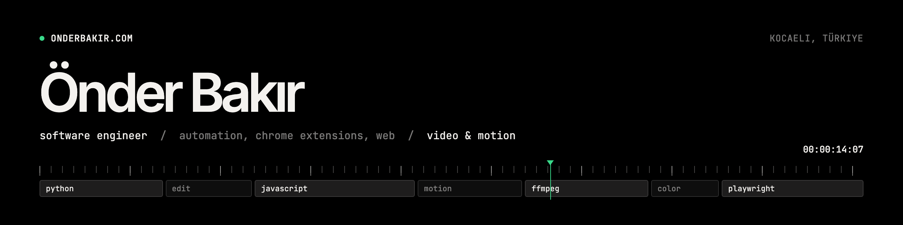

Software engineer at [XON](https://xon.net.tr) in Kocaeli, Türkiye. I work on [puq.ai](https://puq.ai), a visual automation platform for AI workflows. I also edit video and make motion graphics, and lately I render that motion work from code.

B.Sc. in Information Systems Engineering, Burdur Mehmet Akif Ersoy University.

## Selected projects

| Project | What it is | Stack |
|---|---|---|
| [**Web Scanner**](https://webscanner.onderbakir.com) | Chrome extension that finds broken links and grades a site's security basics with passive checks: HTTPS, security headers, cookie flags, SPF and DMARC, exposed files like `.env` or source maps. Scans and history stay in your browser. Chrome Web Store listing coming soon. Site source: [onder007/web-scanner](https://github.com/onder007/web-scanner) | React, Vite, CRXJS, MV3 |
| [**onderbakir.com**](https://onderbakir.com) / [**design.onderbakir.com**](https://design.onderbakir.com) | My developer and design portfolios. A Pages Function streams the design site's videos from Google Drive. | HTML, CSS, JS, Cloudflare Pages |
| **Fatigue tracking system** (private) | A webcam client finds the driver's eyes with Haar cascades and a small Keras CNN labels each eye open or closed. Critical alarms go to a Django backend, which pushes live scores to a React dashboard over WebSockets. | Python, OpenCV, Keras, Django Channels, React |
| **Promo film renderer** (private) | Deterministic HTML canvas scenes captured frame by frame in headless Chromium, encoded with ffmpeg. NumPy and SciPy synthesize the music. | Playwright, ffmpeg, Python |

Most of my repos are private. Ask me if you want a walkthrough.

## What I build

- **Automation and AI workflows.** puq.ai at work. On the side, scripted pipelines that drive a headless browser and ffmpeg.
- **Chrome extensions.** Manifest V3, React and Vite.
- **Web apps and sites.** React and Next.js apps, static sites on Cloudflare Pages.
- **Video and motion graphics.** Short-form video and ad creatives for brands, plus promo films built as code.

## Tech I use

These come from the code in my repositories.

| | |
|---|---|
| Languages | Python, JavaScript, TypeScript, Dart, HTML, CSS |
| Web | React, Next.js, Vite, Chrome Extensions (MV3), Three.js |
| Backend and data | Django, Django REST Framework, Django Channels, Firebase, Supabase Storage |
| AI and computer vision | TensorFlow / Keras, OpenCV, Gemini API |
| Automation and media | Playwright, ffmpeg, NumPy, SciPy |
| Apps | Flutter, PyQt5 |
| Hosting and CI | Cloudflare Pages, Vercel, GitHub Actions |

## Contact

[onderbakir.com](https://onderbakir.com) · [X @onderbakir](https://x.com/onderbakir) · [LinkedIn](https://www.linkedin.com/in/onderbakir)
